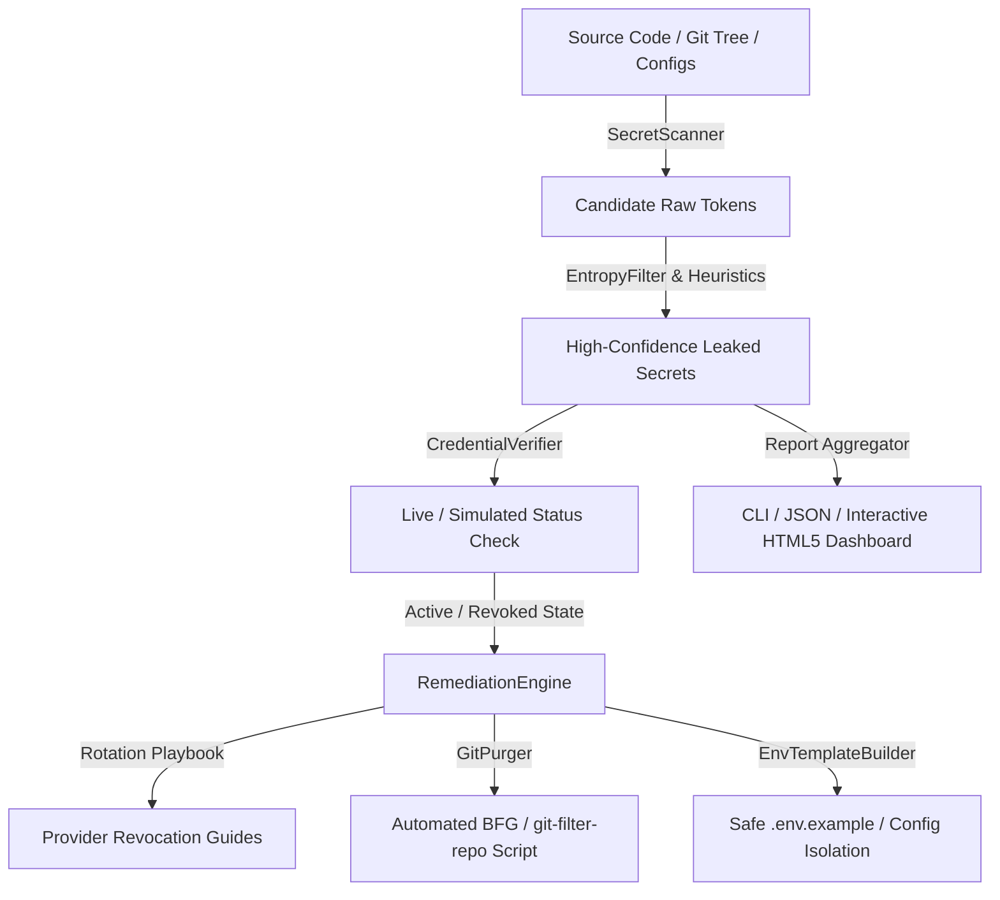

# VaultGuard Architecture

## 1. Executive Summary
VaultGuard is an Autonomous Secret & API Key Leakage Remediator with Proof-of-Revocation and Live Key Verification. It scans source code repositories, commit histories, configuration files, and container manifests for hardcoded secrets, computes Shannon entropy to filter out placeholders, verifies active vs revoked credential status safely, and synthesizes automated rotation playbooks and git purge scripts.

## 2. Architecture Diagram

## 3. Core Engine Components
- **`core/scanner.py`**: Multi-pattern regex scanner detecting 20+ secret archetypes across AWS, GitHub, OpenAI, Slack, Stripe, GCP, databases, and private keys.
- **`core/entropy.py`**: Shannon entropy calculator to validate token randomness and suppress false positives from test placeholders (`EXAMPLEKEY`, `secret123`).
- **`engines/verifier.py`**: Read-only verification engine testing whether detected keys are active or revoked via harmless provider endpoints (or offline verification simulator).
- **`engines/remediation.py`**: Synthesizes provider-specific step-by-step credential rotation playbooks and environment variable extraction.
- **`engines/git_purger.py`**: Generates automated git history purge scripts (`git-filter-repo` and `git filter-branch`) to completely expunge leaked tokens from git trees.
- **`reporters/`**: Console tables, machine-readable JSON reports, and an interactive self-contained HTML5 dashboard.
